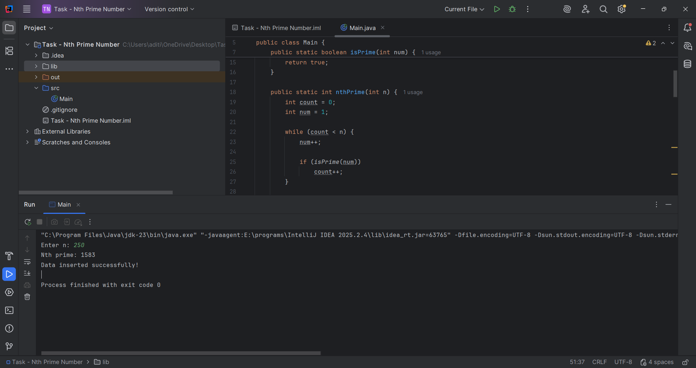
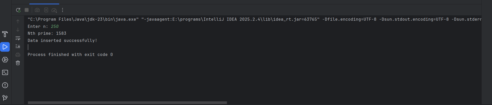
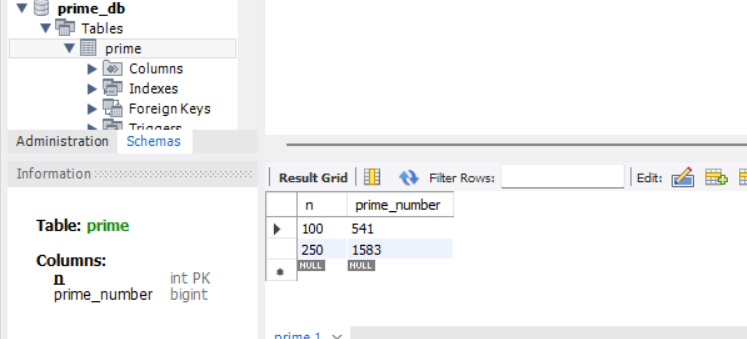
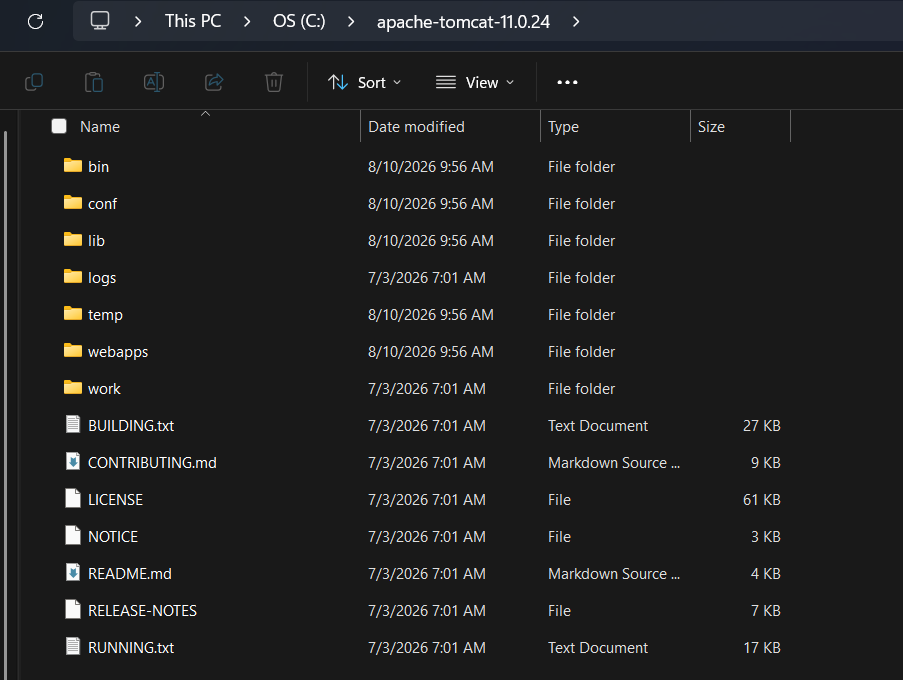
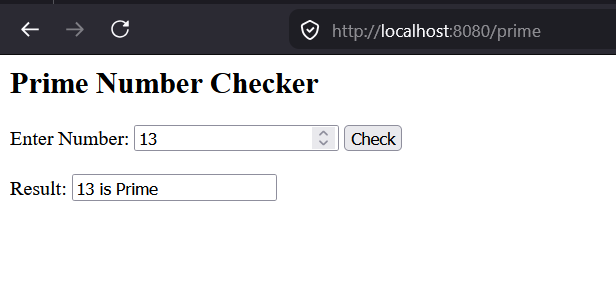

# Java Development and Database Connectivity Lab

**Name:** Ishtiak Ahmed Ayon  
**Student ID:** IT24039  \
**University Email:** it24039@mbstu.ac.bd

**Course:** Software Engineering and Project Management \
**Date:** 1 November 2026

---

## Task 1: IntelliJ IDEA Ultimate Installation

Installed IntelliJ IDEA Ultimate and activated the educational licence through the JetBrains Student Programme using my university email address.

**Verification:** IntelliJ IDEA Ultimate opened and worked successfully.

**Screenshot:**



---

## Task 2: JDBC Database Connectivity – Prime Number Insertion

I developed a Java program that takes an integer `n`, calculates the n-th prime number, and stores the result in a MySQL database using JDBC.

### Database setup

```sql
CREATE DATABASE prime_db;

USE prime_db;

CREATE TABLE prime (
    n INT PRIMARY KEY,
    prime_number BIGINT NOT NULL
);
```

Replace `nickname_name_prime` with your actual table name.

### Main.java

```java
import java.sql.*;
import java.util.Scanner;

public class Main {

    static boolean isPrime(long num) {
        if (num < 2) return false;

        for (long i = 2; i <= num / i; i++) {
            if (num % i == 0) return false;
        }

        return true;
    }

    static long nthPrime(int n) {
        int count = 0;
        long num = 1;

        while (count < n) {
            num++;

            if (isPrime(num)) {
                count++;
            }
        }

        return num;
    }

    public static void main(String[] args) {

        Scanner sc = new Scanner(System.in);

        System.out.print("Enter n: ");
        int n = sc.nextInt();

        if (n < 1) {
            System.out.println("Enter a positive integer.");
            sc.close();
            return;
        }

        long prime = nthPrime(n);

        String url = "jdbc:mysql://localhost:3306/prime_db";
        String user = "root";
        String password = "password";

        String insertSQL =
                "INSERT INTO nickname_name_prime VALUES (?, ?)";

        try (Connection con =
                     DriverManager.getConnection(url, user, password);
             PreparedStatement ps = con.prepareStatement(insertSQL)) {

            ps.setInt(1, n);
            ps.setLong(2, prime);

            ps.executeUpdate();

            System.out.println("The " + n + "th prime number is " + prime);
            System.out.println("Record inserted successfully.");

            String selectSQL =
                    "SELECT * FROM nickname_name_prime WHERE n = ?";

            try (PreparedStatement select =
                         con.prepareStatement(selectSQL)) {

                select.setInt(1, n);

                try (ResultSet rs = select.executeQuery()) {
                    while (rs.next()) {
                        System.out.println(
                                "Stored record: n = " + rs.getInt("n")
                                + ", prime = " + rs.getLong("prime_number")
                        );
                    }
                }
            }

        } catch (SQLException e) {
            e.printStackTrace();
        }

        sc.close();
    }
}
```

### JDBC configuration

- Database: `prime_db`
- Table: `prime`
- JDBC driver: MySQL Connector/J
- JDBC URL: `jdbc:mysql://localhost:3306/prime_db`

The MySQL Connector/J library was added to the project dependencies. The database username and password were configured in the Java program.

### Verification

Example: for `n = 100`, the program calculates `541` and inserts it into the database.

```sql
SELECT * FROM nickname_name_prime;
```

**Screenshots:**





---

## Task 3: Apache Tomcat Server Configuration

Installed Apache Tomcat and configured it in IntelliJ IDEA Ultimate.

### Configuration

1. Downloaded and extracted Apache Tomcat.
2. Opened **Settings → Build, Execution, Deployment → Application Servers**.
3. Added a new Tomcat Server and selected the extracted Tomcat directory.
4. Created a Tomcat Local run configuration.
5. Configured the deployment artifact for the web application.
6. Started the server and checked its status.

**Server URL:** `http://localhost:8080`

**Screenshots:**




---

## Task 4: Browser-Based Primality Testing Using Java Servlet

Created a Java Servlet that accepts an integer from a browser and checks whether it is prime.

### Project structure

```text
PrimeCheckerServlet/
├── pom.xml
└── src/
    └── main/
        └── java/
            └── com/
                └── example/
                    └── PrimeServlet.java
```

### PrimeServlet.java

```java
package com.example;

import jakarta.servlet.ServletException;
import jakarta.servlet.annotation.WebServlet;
import jakarta.servlet.http.HttpServlet;
import jakarta.servlet.http.HttpServletRequest;
import jakarta.servlet.http.HttpServletResponse;

import java.io.IOException;
import java.io.PrintWriter;

@WebServlet("/prime")
public class PrimeServlet extends HttpServlet {

    private boolean isPrime(int num) {
        if (num < 2) return false;

        for (int i = 2; i <= num / i; i++) {
            if (num % i == 0) return false;
        }

        return true;
    }

    @Override
    protected void doGet(HttpServletRequest request,
                         HttpServletResponse response)
            throws ServletException, IOException {

        response.setContentType("text/html;charset=UTF-8");

        PrintWriter out = response.getWriter();

        out.println("<html><head><title>Prime Checker</title></head><body>");
        out.println("<h2>Prime Number Checker</h2>");

        out.println("<form method='post' action='prime'>");
        out.println("<input type='number' name='number' required>");
        out.println("<button type='submit'>Check</button>");
        out.println("</form>");

        out.println("</body></html>");
    }

    @Override
    protected void doPost(HttpServletRequest request,
                          HttpServletResponse response)
            throws ServletException, IOException {

        response.setContentType("text/html;charset=UTF-8");

        PrintWriter out = response.getWriter();

        try {
            int number = Integer.parseInt(
                    request.getParameter("number")
            );

            out.println("<html><body>");
            out.println("<h2>Prime Number Checker</h2>");

            if (isPrime(number)) {
                out.println("<h3>" + number + " is a Prime Number.</h3>");
            } else {
                out.println("<h3>" + number + " is not a Prime Number.</h3>");
            }

            out.println("<a href='prime'>Check another number</a>");
            out.println("</body></html>");

        } catch (NumberFormatException e) {
            out.println("<h3>Please enter a valid integer.</h3>");
            out.println("<a href='prime'>Try again</a>");
        }
    }
}
```

### pom.xml

```xml
<project xmlns="http://maven.apache.org/POM/4.0.0"
         xmlns:xsi="http://www.w3.org/2001/XMLSchema-instance"
         xsi:schemaLocation="http://maven.apache.org/POM/4.0.0
         https://maven.apache.org/xsd/maven-4.0.0.xsd">

    <modelVersion>4.0.0</modelVersion>

    <groupId>com.example</groupId>
    <artifactId>PrimeCheckerServlet</artifactId>
    <version>1.0</version>
    <packaging>war</packaging>

    <properties>
        <maven.compiler.release>17</maven.compiler.release>
        <project.build.sourceEncoding>UTF-8</project.build.sourceEncoding>
    </properties>

    <dependencies>
        <dependency>
            <groupId>jakarta.servlet</groupId>
            <artifactId>jakarta.servlet-api</artifactId>
            <version>6.0.0</version>
            <scope>provided</scope>
        </dependency>
    </dependencies>

    <build>
        <finalName>PrimeCheckerServlet</finalName>
    </build>

</project>
```

### Deployment and testing

- Servlet mapping: `/prime`
- Application context: `/PrimeCheckerServlet`
- Browser URL: `http://localhost:8080/prime`

The application was deployed on the Tomcat server and tested using both prime and non-prime numbers.

| Input | Expected result |
|---:|---|
| 7 | Prime Number |
| 10 | Not a Prime Number |
| 13 | Prime Number |
| 1 | Not a Prime Number |

**Screenshots:**



<!-- 

 -->

---

## GitHub Repository

**Repository:** YOUR_GITHUB_REPOSITORY_URL

