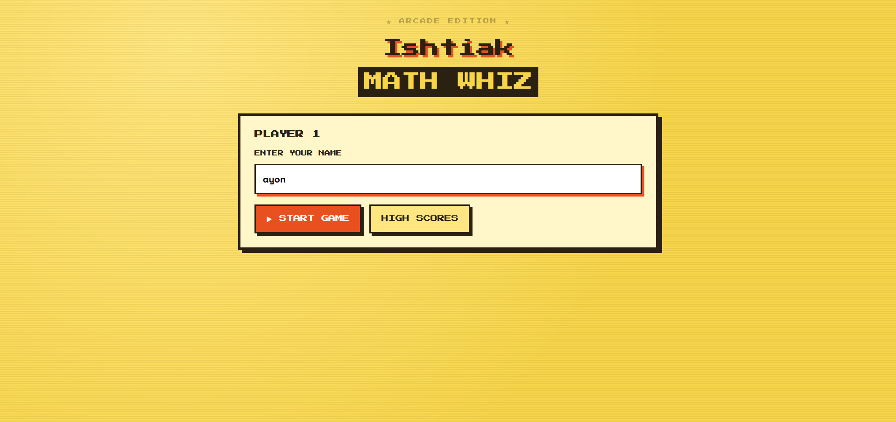
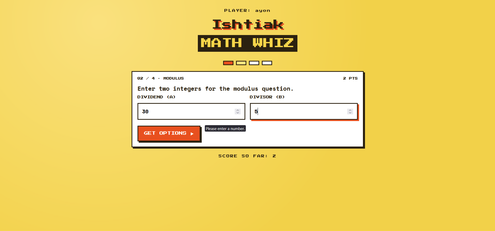
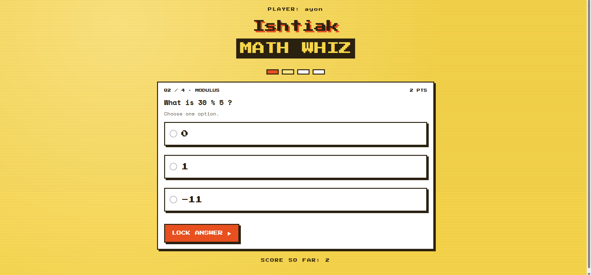
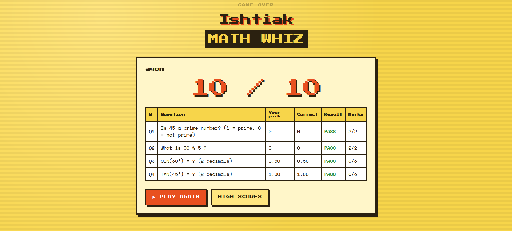
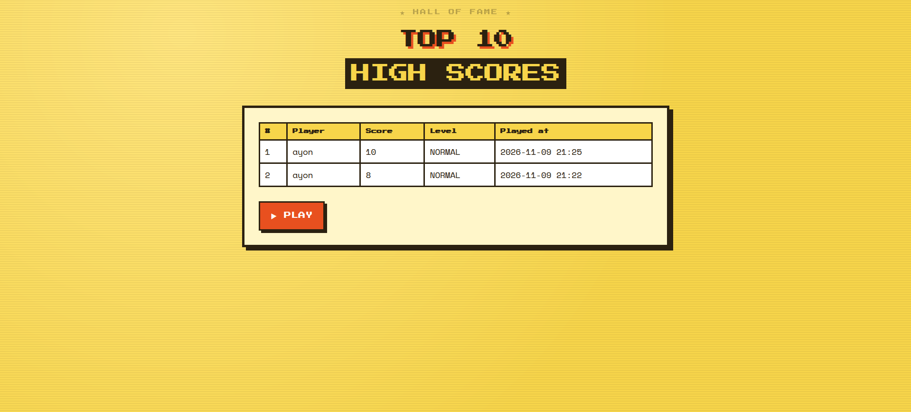

# Ishtiak Ayon – MATH WHIZ

A retro-style web game built with Java Servlets, JSP and JDBC. Each of the four questions is shown one at a time: the player enters the integers, the game calculates the answer with Java methods and offers three options, and the player picks one. Scores are saved to MySQL and shown on a top-10 leaderboard.

---

## Application Screenshots

### Welcome Page


### Game Page: Enter Integers


### Game Page: Choose an Option


### Result Page


### Leaderboard


---

## Index

| Section | Link |
|---|---|
| Objectives | [Objectives](#objectives) |
| Technologies | [Technologies Used](#technologies-used) |
| Requirements | [Software Requirements](#software-requirements) |
| Rules | [Game Rules and Scoring](#game-rules-and-scoring) |
| Structure | [Project Structure](#project-structure) |
| Task 01 | [Project Setup](#task-01-project-setup) |
| Task 02 | [Design the Game Interface](#task-02-design-the-game-interface) |
| Task 03 | [Prime Number Function](#task-03-prime-number-function) |
| Task 04 | [Modulus Function](#task-04-modulus-function) |
| Task 05 | [Trigonometric Functions](#task-05-trigonometric-functions) |
| Task 06 | [Game Logic](#task-06-game-logic) |
| Task 07 | [Database Design Using JDBC](#task-07-database-design-using-jdbc) |
| Task 08 | [Top 10 Leaderboard](#task-08-top-10-leaderboard) |
| Task 09 | [Testing and Validation](#task-09-testing-and-validation) |
| Task 10 | [Documentation and GitHub Submission](#task-10-documentation-and-github-submission) |
| Setup | [Database Configuration](#database-configuration) |
| Run | [Steps to Run](#steps-to-run) |
| Link | [GitHub Project Link](#github-project-link) |

---

## Objectives

- Build reusable Java methods for prime, modulus and trigonometric calculations.
- Generate multiple-choice options programmatically from a calculated answer.
- Process requests and responses with a Servlet and keep game state in the session.
- Use JDBC with `PreparedStatement` to insert and query records.
- Sort and display a top-10 leaderboard.
- Document and submit the project through GitHub.

## Technologies Used

| Layer | Technology |
|---|---|
| Language | Java 11 |
| Web | Servlet 4.0, JSP, JSTL 1.2 |
| Server | Jetty 9.4 (via `jetty-maven-plugin`) |
| Build | Maven |
| Database | MySQL 8, JDBC (`mysql-connector-java` 8.0.33) |
| Testing | JUnit 5 |
| UI | HTML, CSS (retro-modern, yellow theme) |

## Software Requirements

- JDK 11 or newer
- Apache Maven 3.6+
- MySQL Server 8+
- IntelliJ IDEA (any IDE works)
- Internet on first run (Maven downloads; Google Fonts for the pixel font, with a monospace fallback offline)

## Game Rules and Scoring

### How a question works

| Step | What happens |
|---|---|
| 1 | One question is shown at a time (Q1 to Q4) |
| 2 | The player enters the integers for that question |
| 3 | The game calculates the correct answer with the Java methods |
| 4 | The game shows three options: the correct one and two wrong ones |
| 5 | The player picks one option; the right pick earns the marks |

### Questions

| Question | Area | Player enters | Marks |
|---|---|---|---|
| Q1 | Prime number | one integer | 2 |
| Q2 | Modulus | two integers (dividend, divisor) | 2 |
| Q3 | Trigonometry | function (sin / cos / tan) and an angle in degrees | 3 |
| Q4 | Trigonometry | function (sin / cos / tan) and an angle in degrees | 3 |
| | | **Total** | **10** |

### Rules

- Prime: returns `1` if prime, otherwise `0`. Numbers below 2 are not prime.
- Modulus: integers only. A zero divisor shows a validation error.
- Trigonometry: angles are in degrees and converted to radians before `Math.sin/cos/tan`. An undefined tangent (90°, 270°) shows an error.
- Options: three per question. The two wrong options are random numbers within ±20 of the correct answer, never equal to it or to each other. Trig options are decimals with 2 places.
- The correct option is placed at a random position, and the server keeps its index, so the answer is not sent to the browser.
- Difficulty is `NORMAL` for every question and is stored with each score.

---

## Project Structure

```
MathWhiz/
├── pom.xml
├── README.md
├── .gitignore
├── database/
│   └── math_whiz_db.sql
├── screenshots/
│   ├── home.png
│   ├── game-input.png
│   ├── game-options.png
│   ├── result.png
│   └── leaderboard.png
└── src/
    ├── main/
    │   ├── java/com/example/
    │   │   ├── servlet/GameServlet.java
    │   │   ├── model/GameState.java
    │   │   ├── model/Choices.java
    │   │   ├── model/QuestionResult.java
    │   │   ├── model/GameScore.java
    │   │   ├── service/MathService.java
    │   │   └── dao/ScoreDAO.java
    │   └── webapp/
    │       ├── index.jsp
    │       ├── game.jsp
    │       ├── result.jsp
    │       ├── leaderboard.jsp
    │       └── css/style.css
    └── test/
        └── java/com/example/service/MathServiceTest.java
```

| File | Role |
|---|---|
| `com.example.servlet.GameServlet` | Controller: start, generate options, check answer, show leaderboard |
| `com.example.model.GameState` | One play in the session: current question, score, results |
| `com.example.model.Choices` | Three options and the index of the correct one |
| `com.example.model.QuestionResult` | Outcome of one answered question |
| `com.example.model.GameScore` | One row of `game_scores` |
| `com.example.service.MathService` | Math functions and option generation |
| `com.example.dao.ScoreDAO` | JDBC insert and top-10 select |
| `*.jsp` | The screens |
| `style.css` | Retro-modern yellow theme |

---

## Task 01: Project Setup

**Goal:** a Maven web project that runs on Jetty and connects to MySQL through JDBC.

### Step 1: Create the folders

```bash
mkdir -p MathWhiz/src/main/java/com/example/{servlet,model,service,dao}
mkdir -p MathWhiz/src/main/webapp/css
mkdir -p MathWhiz/src/test/java/com/example/service
mkdir -p MathWhiz/database MathWhiz/screenshots
```

In IntelliJ: open the `MathWhiz` folder, then right-click `pom.xml` > **Add as Maven Project**.

### Step 2: Create `pom.xml`

```xml
<project xmlns="http://maven.apache.org/POM/4.0.0">
  <modelVersion>4.0.0</modelVersion>
  <groupId>com.example</groupId>
  <artifactId>MathWhiz</artifactId>
  <version>1.0</version>
  <packaging>war</packaging>

  <properties>
    <maven.compiler.source>11</maven.compiler.source>
    <maven.compiler.target>11</maven.compiler.target>
    <project.build.sourceEncoding>UTF-8</project.build.sourceEncoding>
    <failOnMissingWebXml>false</failOnMissingWebXml>
  </properties>

  <dependencies>
    <dependency>
      <groupId>javax.servlet</groupId>
      <artifactId>javax.servlet-api</artifactId>
      <version>4.0.1</version>
      <scope>provided</scope>
    </dependency>
    <dependency>
      <groupId>javax.servlet</groupId>
      <artifactId>jstl</artifactId>
      <version>1.2</version>
    </dependency>
    <dependency>
      <groupId>mysql</groupId>
      <artifactId>mysql-connector-java</artifactId>
      <version>8.0.33</version>
    </dependency>
    <dependency>
      <groupId>org.junit.jupiter</groupId>
      <artifactId>junit-jupiter</artifactId>
      <version>5.10.2</version>
      <scope>test</scope>
    </dependency>
  </dependencies>

  <build>
    <plugins>
      <plugin>
        <groupId>org.eclipse.jetty</groupId>
        <artifactId>jetty-maven-plugin</artifactId>
        <version>9.4.53.v20231009</version>
        <configuration>
          <webApp><contextPath>/</contextPath></webApp>
        </configuration>
      </plugin>
    </plugins>
  </build>
</project>
```

| `pom.xml` part | Why |
|---|---|
| `packaging` = `war` | Web application |
| Java 11 (source/target) | Language level used by the code |
| `javax.servlet-api` (provided) | Servlet API at compile time; Jetty supplies it at runtime |
| `jstl` | `<c:forEach>`, `<c:if>`, `<fmt:formatDate>` in JSPs |
| `mysql-connector-java` 8.0.33 | JDBC driver |
| `junit-jupiter` (test) | Unit tests for `MathService` and `GameState` |
| `jetty-maven-plugin` 9.4.53 | Runs the app with `mvn jetty:run` on port 8080, no separate server install |

### Step 3: Configure JDBC

JDBC settings are constants at the top of `ScoreDAO.java` (full file in [Task 07](#task-07-database-design-using-jdbc)):

```java
private static final String URL = "jdbc:mysql://localhost:3306/math_whiz_db?useSSL=false&allowPublicKeyRetrieval=true&serverTimezone=UTC";
private static final String USER = "root";
private static final String PASSWORD = "1234pass";
```

Replace `YOUR_DB_PASSWORD` with your MySQL password before running.

### Step 4: Verify the setup

1. Create the database ([Database Configuration](#database-configuration)).
2. Add all files from the tasks below.
3. Run `mvn jetty:run` and open `http://localhost:8080/`.

Expected: the Welcome page loads and the Maven console shows `Started ServerConnector`.

---

## Task 02: Design the Game Interface

**Goal:** screens with form handling, in a retro-modern yellow style.

### Screen flow

```
index.jsp ──start──▶ game.jsp (Q1: enter integers)
                        │ generate
                        ▼
                     game.jsp (Q1: choose 1 of 3 options)
                        │ answer
                        ▼
                     game.jsp (Q2 ... Q4, same two steps)
                        │ after Q4
                        ▼
leaderboard.jsp ◀── result.jsp
```

### Form parameters

All forms post to `/game` with a hidden `action`.

| Screen | `action` | Fields |
|---|---|---|
| index.jsp | `start` | `playerName` (1–100 chars) |
| game.jsp, Q1 input | `generate` | `n` |
| game.jsp, Q2 input | `generate` | `a`, `b` |
| game.jsp, Q3 and Q4 input | `generate` | `fn` (sin / cos / tan), `angle` |
| game.jsp, options | `answer` | `choice` (index 0–2) |
| leaderboard link | GET `?action=leaderboard` | none |

### Design tokens

| Token | Value | Use |
|---|---|---|
| `--bg` | `#f7d54a` | Page yellow |
| `--bg2` | `#ffe680` | Light yellow highlight |
| `--paper` | `#fff6c9` | Panels |
| `--ink` | `#2b2110` | Text and thick borders |
| `--accent` | `#e8501f` | Buttons, score |
| Heading font | Press Start 2P | Pixel look |
| Body font | Space Mono | Readable monospace |
| Effects | 4px borders, hard offset shadows, faint scanlines | Retro-modern |

### `src/main/webapp/index.jsp`

```jsp
<%@ page contentType="text/html;charset=UTF-8" language="java" %>
<%@ taglib prefix="c" uri="http://java.sun.com/jsp/jstl/core" %>
<!DOCTYPE html>
<html lang="en">
<head>
  <meta charset="UTF-8">
  <meta name="viewport" content="width=device-width, initial-scale=1">
  <title>Ishtiak – MATH WHIZ</title>
  <link rel="stylesheet" href="${pageContext.request.contextPath}/css/style.css">
</head>
<body>
<main class="screen">
  <header class="marquee">
    <p class="tag">★ ARCADE EDITION ★</p>
    <h1>Ishtiak<br><span>MATH WHIZ</span></h1>
  </header>

  <section class="panel">
    <h2>PLAYER 1</h2>
    <c:if test="${not empty error}">
      <p class="alert"><c:out value="${error}"/></p>
    </c:if>
    <form action="${pageContext.request.contextPath}/game" method="post">
      <input type="hidden" name="action" value="start">
      <label for="playerName">ENTER YOUR NAME</label>
      <input id="playerName" name="playerName" maxlength="100" required autofocus autocomplete="off">
      <div class="actions">
        <button class="btn" type="submit">▶ START GAME</button>
        <a class="btn alt" href="${pageContext.request.contextPath}/game?action=leaderboard">HIGH SCORES</a>
      </div>
    </form>
  </section>
</main>
</body>
</html>
```

### `src/main/webapp/game.jsp`

Shows the progress bar, then either the input form (step 1) or the three options (step 2), depending on `game.choosing`.

```jsp
<%@ page contentType="text/html;charset=UTF-8" language="java" %>
<%@ taglib prefix="c" uri="http://java.sun.com/jsp/jstl/core" %>
<c:if test="${empty game}"><c:redirect url="/index.jsp"/></c:if>
<!DOCTYPE html>
<html lang="en">
<head>
  <meta charset="UTF-8">
  <meta name="viewport" content="width=device-width, initial-scale=1">
  <title>YOUR NAME – MATH WHIZ</title>
  <link rel="stylesheet" href="${pageContext.request.contextPath}/css/style.css">
</head>
<body>
<main class="screen">
  <header class="marquee">
    <p class="tag">PLAYER: <c:out value="${game.playerName}"/></p>
    <h1>YOUR NAME<br><span>MATH WHIZ</span></h1>
  </header>

  <div class="progress">
    <c:forEach begin="1" end="4" var="n">
      <i class="${n lt game.questionNumber ? 'done' : (n eq game.questionNumber ? 'now' : '')}"></i>
    </c:forEach>
  </div>

  <section class="q">
    <div class="meta">
      <span>Q${game.questionNumber} / ${game.total} · ${game.title}</span>
      <span>${game.marks} PTS</span>
    </div>

    <c:if test="${not empty error}">
      <p class="alert"><c:out value="${error}"/></p>
    </c:if>

    <c:choose>
      <c:when test="${not game.choosing}">
        <form action="${pageContext.request.contextPath}/game" method="post">
          <input type="hidden" name="action" value="generate">
          <c:choose>
            <c:when test="${game.type == 'PRIME'}">
              <p class="text">Enter an integer. The game will ask if it is prime.</p>
              <label for="n">YOUR INTEGER</label>
              <input id="n" type="number" name="n" step="1" required autofocus>
            </c:when>
            <c:when test="${game.type == 'MOD'}">
              <p class="text">Enter two integers for the modulus question.</p>
              <div class="row">
                <div>
                  <label for="a">DIVIDEND (A)</label>
                  <input id="a" type="number" name="a" step="1" required autofocus>
                </div>
                <div>
                  <label for="b">DIVISOR (B)</label>
                  <input id="b" type="number" name="b" step="1" required>
                </div>
              </div>
            </c:when>
            <c:otherwise>
              <p class="text">Pick a function and enter an angle in degrees.</p>
              <div class="row">
                <div>
                  <label for="fn">FUNCTION</label>
                  <select id="fn" name="fn">
                    <option value="sin">SIN</option>
                    <option value="cos">COS</option>
                    <option value="tan">TAN</option>
                  </select>
                </div>
                <div>
                  <label for="angle">ANGLE (DEG)</label>
                  <input id="angle" type="number" name="angle" step="1" required autofocus>
                </div>
              </div>
            </c:otherwise>
          </c:choose>
          <button class="btn" type="submit">GET OPTIONS ▶</button>
        </form>
      </c:when>

      <c:otherwise>
        <form action="${pageContext.request.contextPath}/game" method="post">
          <input type="hidden" name="action" value="answer">
          <p class="text"><c:out value="${game.prompt}"/></p>
          <p class="hint">Choose one option.</p>
          <div class="opts">
            <c:forEach var="o" items="${game.choices.options}" varStatus="st">
              <label class="opt">
                <input type="radio" name="choice" value="${st.index}" required>
                <span><c:out value="${o}"/></span>
              </label>
            </c:forEach>
          </div>
          <button class="btn" type="submit">LOCK ANSWER ▶</button>
        </form>
      </c:otherwise>
    </c:choose>
  </section>

  <p class="tag">SCORE SO FAR: ${game.score}</p>
</main>
</body>
</html>
```

### `src/main/webapp/result.jsp`

```jsp
<%@ page contentType="text/html;charset=UTF-8" language="java" %>
<%@ taglib prefix="c" uri="http://java.sun.com/jsp/jstl/core" %>
<!DOCTYPE html>
<html lang="en">
<head>
  <meta charset="UTF-8">
  <meta name="viewport" content="width=device-width, initial-scale=1">
  <title>YOUR NAME – MATH WHIZ</title>
  <link rel="stylesheet" href="${pageContext.request.contextPath}/css/style.css">
</head>
<body>
<main class="screen">
  <header class="marquee">
    <p class="tag">GAME OVER</p>
    <h1>YOUR NAME<br><span>MATH WHIZ</span></h1>
  </header>

  <section class="panel">
    <h2><c:out value="${playerName}"/></h2>
    <p class="score">${score} / 10</p>

    <c:if test="${not empty dbError}">
      <p class="alert"><c:out value="${dbError}"/></p>
    </c:if>

    <div class="table-wrap">
      <table>
        <tr><th>Q</th><th>Question</th><th>Your pick</th><th>Correct</th><th>Result</th><th>Marks</th></tr>
        <c:forEach var="r" items="${results}" varStatus="st">
          <tr>
            <td>Q${st.count}</td>
            <td><c:out value="${r.prompt}"/></td>
            <td><c:out value="${r.chosen}"/></td>
            <td><c:out value="${r.correct}"/></td>
            <td class="${r.right ? 'ok' : 'bad'}">${r.right ? 'PASS' : 'FAIL'}</td>
            <td>${r.marks}/${r.maxMarks}</td>
          </tr>
        </c:forEach>
      </table>
    </div>

    <div class="actions spaced">
      <a class="btn" href="${pageContext.request.contextPath}/index.jsp">▶ PLAY AGAIN</a>
      <a class="btn alt" href="${pageContext.request.contextPath}/game?action=leaderboard">HIGH SCORES</a>
    </div>
  </section>
</main>
</body>
</html>
```

### `src/main/webapp/leaderboard.jsp`

```jsp
<%@ page contentType="text/html;charset=UTF-8" language="java" %>
<%@ taglib prefix="c" uri="http://java.sun.com/jsp/jstl/core" %>
<%@ taglib prefix="fmt" uri="http://java.sun.com/jsp/jstl/fmt" %>
<!DOCTYPE html>
<html lang="en">
<head>
  <meta charset="UTF-8">
  <meta name="viewport" content="width=device-width, initial-scale=1">
  <title>YOUR NAME – MATH WHIZ</title>
  <link rel="stylesheet" href="${pageContext.request.contextPath}/css/style.css">
</head>
<body>
<main class="screen">
  <header class="marquee">
    <p class="tag">★ HALL OF FAME ★</p>
    <h1>TOP 10<br><span>HIGH SCORES</span></h1>
  </header>

  <section class="panel">
    <c:if test="${not empty error}">
      <p class="alert"><c:out value="${error}"/></p>
    </c:if>

    <div class="table-wrap">
      <table>
        <tr><th>#</th><th>Player</th><th>Score</th><th>Level</th><th>Played at</th></tr>
        <c:forEach var="s" items="${scores}" varStatus="st">
          <tr>
            <td>${st.count}</td>
            <td><c:out value="${s.playerName}"/></td>
            <td>${s.score}</td>
            <td>${s.difficulty}</td>
            <td><fmt:formatDate value="${s.playedAt}" pattern="yyyy-MM-dd HH:mm"/></td>
          </tr>
        </c:forEach>
        <c:if test="${empty scores}">
          <tr><td colspan="5">NO SCORES YET. BE THE FIRST!</td></tr>
        </c:if>
      </table>
    </div>

    <div class="actions spaced">
      <a class="btn" href="${pageContext.request.contextPath}/index.jsp">▶ PLAY</a>
    </div>
  </section>
</main>
</body>
</html>
```

### `src/main/webapp/css/style.css`

```css
@import url('https://fonts.googleapis.com/css2?family=Press+Start+2P&family=Space+Mono:wght@400;700&display=swap');

:root {
  --bg: #f7d54a;
  --bg2: #ffe680;
  --paper: #fff6c9;
  --ink: #2b2110;
  --accent: #e8501f;
  --ok: #2f8f3a;
  --bad: #c62828;
  --pixel: 'Press Start 2P', 'Courier New', monospace;
  --body: 'Space Mono', 'Courier New', monospace;
}

* { box-sizing: border-box; }

body {
  margin: 0;
  min-height: 100vh;
  display: flex;
  justify-content: center;
  padding: 32px 16px;
  font-family: var(--body);
  color: var(--ink);
  background:
    repeating-linear-gradient(0deg, rgba(43, 33, 16, .06) 0 2px, transparent 2px 4px),
    radial-gradient(circle at 20% 10%, var(--bg2), var(--bg) 60%);
}

.screen { width: 100%; max-width: 720px; }

.marquee { text-align: center; margin-bottom: 28px; }

.tag {
  font-family: var(--pixel);
  font-size: 10px;
  letter-spacing: 2px;
  margin: 0 0 14px;
}

h1 {
  font-family: var(--pixel);
  font-size: clamp(20px, 5vw, 32px);
  line-height: 1.5;
  margin: 0;
  text-shadow: 4px 4px 0 var(--accent);
}

h1 span {
  display: inline-block;
  margin-top: 8px;
  padding: 2px 10px;
  background: var(--ink);
  color: var(--bg);
  text-shadow: none;
}

.panel {
  background: var(--paper);
  border: 4px solid var(--ink);
  box-shadow: 6px 6px 0 var(--ink);
  padding: 24px;
  margin-bottom: 24px;
}

.panel h2 { font-family: var(--pixel); font-size: 14px; margin: 0 0 18px; }

label {
  display: block;
  font-family: var(--pixel);
  font-size: 10px;
  line-height: 1.6;
  margin-bottom: 10px;
}

input, select {
  width: 100%;
  padding: 12px;
  margin-bottom: 18px;
  font: 700 16px var(--body);
  background: #fff;
  border: 3px solid var(--ink);
  outline: none;
}

input:focus, select:focus { box-shadow: 4px 4px 0 var(--accent); }

.btn {
  display: inline-block;
  padding: 14px 18px;
  font-family: var(--pixel);
  font-size: 12px;
  color: #fff;
  background: var(--accent);
  border: 3px solid var(--ink);
  box-shadow: 4px 4px 0 var(--ink);
  text-decoration: none;
  cursor: pointer;
}

.btn:hover { background: #ff6a3a; }
.btn:active { transform: translate(4px, 4px); box-shadow: none; }
.btn.alt { background: var(--bg2); color: var(--ink); }

.actions { display: flex; gap: 14px; flex-wrap: wrap; }
.actions.spaced { margin-top: 24px; }

.q {
  background: #fff;
  border: 3px solid var(--ink);
  box-shadow: 4px 4px 0 var(--ink);
  padding: 16px;
  margin-bottom: 22px;
}

.q .meta {
  display: flex;
  justify-content: space-between;
  font-family: var(--pixel);
  font-size: 9px;
  margin-bottom: 12px;
}

.q .text { font-size: 18px; font-weight: 700; margin: 0 0 6px; }
.q .hint { font-size: 13px; opacity: .75; margin: 0 0 12px; }
.upper { text-transform: uppercase; }

.score {
  font-family: var(--pixel);
  font-size: clamp(28px, 8vw, 56px);
  text-align: center;
  color: var(--accent);
  text-shadow: 4px 4px 0 var(--ink);
  margin: 10px 0 24px;
}

.table-wrap { overflow-x: auto; }

table { width: 100%; border-collapse: collapse; background: #fff; font-size: 14px; }
th, td { border: 3px solid var(--ink); padding: 8px; text-align: left; }
th { font-family: var(--pixel); font-size: 9px; background: var(--bg); }

.ok { color: var(--ok); font-weight: 700; }
.bad { color: var(--bad); font-weight: 700; }

.alert {
  background: var(--bad);
  color: #fff;
  font-weight: 700;
  padding: 10px;
  border: 3px solid var(--ink);
}

@keyframes blink { 50% { opacity: .3; } }
@media (prefers-reduced-motion: no-preference) {
  .tag { animation: blink 1.2s steps(2) infinite; }
}

.row { display: grid; grid-template-columns: 1fr 1fr; gap: 14px; }

.opts { display: grid; gap: 14px; margin-bottom: 22px; }

.opt {
  display: flex;
  align-items: center;
  gap: 14px;
  padding: 14px;
  background: #fff;
  border: 3px solid var(--ink);
  box-shadow: 4px 4px 0 var(--ink);
  font-size: 18px;
  font-weight: 700;
  cursor: pointer;
}

.opt input { width: auto; margin: 0; transform: scale(1.4); accent-color: var(--accent); }
.opt:hover { background: var(--bg2); }
.opt:has(input:checked) { background: var(--bg); box-shadow: none; transform: translate(4px, 4px); }

.progress { display: flex; justify-content: center; gap: 8px; margin-bottom: 18px; }
.progress i { width: 32px; height: 14px; background: #fff; border: 3px solid var(--ink); }
.progress i.done { background: var(--accent); }
.progress i.now { background: var(--bg2); }

.screen > .tag { text-align: center; }
```

---

## Task 03: Prime Number Function

**Goal:** `public static int isPrime(int number)` returns `1` for prime, `0` otherwise.

### Algorithm

1. If `number < 2`, return `0` (0, 1 and negatives are not prime).
2. Test divisors `i = 2, 3, 4, ...` while `i * i <= number`.
3. If any `i` divides `number` evenly, return `0`.
4. Otherwise return `1`.

Why stop at `i * i <= number`: if `number = a × b`, one factor is at most √number, so checking beyond it finds nothing new.

### Code (in `MathService.java`)

```java
public static int isPrime(int number) {
    if (number < 2) {
        return 0;
    }
    for (int i = 2; i * i <= number; i++) {
        if (number % i == 0) {
            return 0;
        }
    }
    return 1;
}
```

### Dry run

| Input | Check | Result |
|---|---|---|
| `-5`, `0`, `1` | `< 2` | `0` |
| `2` | loop skipped (`2*2 > 2`) | `1` |
| `7` | `i=2`: 7%2=1, then `i*i=9 > 7`, stop | `1` |
| `8` | `i=2`: 8%2=0 | `0` |
| `9` | `i=2`: 1, `i=3`: 9%3=0 | `0` |
| `97` | `i` up to 9, none divide | `1` |

### How the game uses it

- Q1: the player enters an integer `n`; the servlet calls `isPrime(n)` to get the correct answer (`1` or `0`).
- `MathService.intChoices(...)` then builds the three options around that answer.

### Student activity: test it

Covered by `MathServiceTest.prime()` in [Task 09](#task-09-testing-and-validation). Run `mvn test`.

---

## Task 04: Modulus Function

**Goal:** `public static int calculateMod(int a, int b)` returns the remainder of integer division.

```java
public static int calculateMod(int a, int b) {
    if (b == 0) {
        throw new IllegalArgumentException("Divisor must not be zero");
    }
    return a % b;
}
```

| Input | Result | Note |
|---|---|---|
| `17, 5` | `2` | |
| `-17, 5` | `-2` | Result takes the sign of the dividend |
| `17, -5` | `2` | |
| `0, 5` | `0` | |
| `5, 0` | error | `IllegalArgumentException`, shown on the game page |

### How the game uses it

- Q2: the player enters `a` and `b` (integers only; non-integers are rejected).
- A zero divisor shows "Divisor must not be zero" and the player re-enters the numbers.

---

## Task 05: Trigonometric Functions

**Goal:** sine, cosine and tangent from angles in degrees.

```java
public static double calculateSin(double degree) {
    return Math.sin(Math.toRadians(degree));
}

public static double calculateCos(double degree) {
    return Math.cos(Math.toRadians(degree));
}

public static double calculateTan(double degree) {
    double radian = Math.toRadians(degree);
    if (Math.abs(Math.cos(radian)) < 1e-10) {
        return Double.NaN;
    }
    return Math.tan(radian);
}
```

- Degrees are converted with `Math.toRadians` (`degree × π / 180`).
- Tangent is undefined where cosine is 0 (90°, 270°): the method returns `Double.NaN` and the servlet shows "tan(90°) is undefined".
- Reference identity: `sin²θ + cos²θ = 1` (the `x² + y² = 1` circle).
- `calculateTrig(String fn, double degree)` picks the method from `"sin"`, `"cos"` or `"tan"`.

| Angle | sin | cos | tan |
|---|---|---|---|
| 0° | 0 | 1 | 0 |
| 30° | 0.5 | 0.8660 | 0.5774 |
| 45° | 0.7071 | 0.7071 | 1 |
| 60° | 0.8660 | 0.5 | 1.7321 |
| 90° | 1 | 0 | undefined |

### How the game uses it

- Q3 and Q4: the player picks sin, cos or tan and enters an angle.
- The correct value is rounded to 2 decimals and shown among the options.

---

## Task 06: Game Logic

**Goal:** integrate the math functions into a game that shows one question at a time with three options.

### Flow

| Step | Servlet action | Code |
|---|---|---|
| Start game | `start` | Creates `GameState` in the session |
| Player enters integers | `generate` | Validates input, calls the math method, builds `Choices` |
| Player picks an option | `answer` | `GameState.answer(choice)` adds marks if correct |
| After Q4 | `answer` | Saves the score, shows `result.jsp` |

### Option generation (`MathService`)

| Rule | Implementation |
|---|---|
| Two wrong options | `ThreadLocalRandom` offset in `[-20, +20]` added to the correct answer |
| Never the correct answer | Offset result equal to the answer is rejected |
| No duplicates | Integers go in a `Set`; decimals must differ by at least 0.05 |
| Random position | `Collections.shuffle`, then the correct index is recorded |
| Decimal answers | Rounded to 2 places for display |

### Scoring

Marks per question are `{2, 2, 3, 3}`. Inside `GameState.answer(int)`:

```java
int earned = choice == choices.getCorrectIndex() ? MARKS[index] : 0;
score += earned;
```

Maximum score: 10.

### `src/main/java/com/example/model/GameState.java`

```java
package com.example.model;

import java.io.Serializable;
import java.util.ArrayList;
import java.util.List;

public class GameState implements Serializable {

    public static final int TOTAL = 4;
    private static final int[] MARKS = {2, 2, 3, 3};

    private final String playerName;
    private final List<QuestionResult> results = new ArrayList<>();
    private int index;
    private int score;
    private String prompt;
    private Choices choices;

    public GameState(String playerName) {
        this.playerName = playerName;
    }

    public String getPlayerName() { return playerName; }
    public int getScore() { return score; }
    public int getTotal() { return TOTAL; }
    public int getQuestionNumber() { return index + 1; }
    public int getMarks() { return MARKS[Math.min(index, TOTAL - 1)]; }
    public String getPrompt() { return prompt; }
    public Choices getChoices() { return choices; }
    public List<QuestionResult> getResults() { return results; }
    public boolean isChoosing() { return choices != null; }
    public boolean isFinished() { return index >= TOTAL; }

    public String getType() {
        if (index == 0) return "PRIME";
        if (index == 1) return "MOD";
        return "TRIG";
    }

    public String getTitle() {
        switch (getType()) {
            case "PRIME": return "PRIME NUMBER";
            case "MOD": return "MODULUS";
            default: return "TRIGONOMETRY";
        }
    }

    public void startChoosing(String prompt, Choices choices) {
        this.prompt = prompt;
        this.choices = choices;
    }

    public void answer(int choice) {
        int earned = choice == choices.getCorrectIndex() ? MARKS[index] : 0;
        results.add(new QuestionResult(prompt, choices.getOptions()[choice], choices.getCorrectText(), earned, MARKS[index]));
        score += earned;
        index++;
        prompt = null;
        choices = null;
    }
}
```

### `src/main/java/com/example/model/Choices.java`

```java
package com.example.model;

import java.io.Serializable;

public class Choices implements Serializable {

    private final String[] options;
    private final int correctIndex;

    public Choices(String[] options, int correctIndex) {
        this.options = options;
        this.correctIndex = correctIndex;
    }

    public String[] getOptions() { return options; }
    public int getCorrectIndex() { return correctIndex; }
    public String getCorrectText() { return options[correctIndex]; }
}
```

### `src/main/java/com/example/model/QuestionResult.java`

```java
package com.example.model;

import java.io.Serializable;

public class QuestionResult implements Serializable {

    private final String prompt;
    private final String chosen;
    private final String correct;
    private final int marks;
    private final int maxMarks;

    public QuestionResult(String prompt, String chosen, String correct, int marks, int maxMarks) {
        this.prompt = prompt;
        this.chosen = chosen;
        this.correct = correct;
        this.marks = marks;
        this.maxMarks = maxMarks;
    }

    public String getPrompt() { return prompt; }
    public String getChosen() { return chosen; }
    public String getCorrect() { return correct; }
    public int getMarks() { return marks; }
    public int getMaxMarks() { return maxMarks; }
    public boolean isRight() { return marks > 0; }
}
```

### `src/main/java/com/example/service/MathService.java`

```java
package com.example.service;

import com.example.model.Choices;

import java.util.ArrayList;
import java.util.Collections;
import java.util.LinkedHashSet;
import java.util.List;
import java.util.Locale;
import java.util.Set;
import java.util.concurrent.ThreadLocalRandom;

public class MathService {

    private static final int RANGE = 20;
    private static final double MIN_GAP = 0.05;

    public static int isPrime(int number) {
        if (number < 2) {
            return 0;
        }
        for (int i = 2; i * i <= number; i++) {
            if (number % i == 0) {
                return 0;
            }
        }
        return 1;
    }

    public static int calculateMod(int a, int b) {
        if (b == 0) {
            throw new IllegalArgumentException("Divisor must not be zero");
        }
        return a % b;
    }

    public static double calculateSin(double degree) {
        return Math.sin(Math.toRadians(degree));
    }

    public static double calculateCos(double degree) {
        return Math.cos(Math.toRadians(degree));
    }

    public static double calculateTan(double degree) {
        double radian = Math.toRadians(degree);
        if (Math.abs(Math.cos(radian)) < 1e-10) {
            return Double.NaN;
        }
        return Math.tan(radian);
    }

    public static double calculateTrig(String fn, double degree) {
        switch (fn) {
            case "sin": return calculateSin(degree);
            case "cos": return calculateCos(degree);
            case "tan": return calculateTan(degree);
            default: throw new IllegalArgumentException("Unknown function: " + fn);
        }
    }

    public static Choices intChoices(int correct) {
        ThreadLocalRandom rnd = ThreadLocalRandom.current();
        Set<Long> wrong = new LinkedHashSet<>();
        while (wrong.size() < 2) {
            long d = (long) correct + rnd.nextInt(-RANGE, RANGE + 1);
            if (d != correct) {
                wrong.add(d);
            }
        }
        List<String> options = new ArrayList<>();
        options.add(String.valueOf(correct));
        for (long d : wrong) {
            options.add(String.valueOf(d));
        }
        return shuffled(options, String.valueOf(correct));
    }

    public static Choices decimalChoices(double correct) {
        ThreadLocalRandom rnd = ThreadLocalRandom.current();
        double right = round2(correct);
        List<Double> wrong = new ArrayList<>();
        while (wrong.size() < 2) {
            double d = round2(right + rnd.nextDouble(-RANGE, RANGE));
            if (Math.abs(d - right) < MIN_GAP) {
                continue;
            }
            boolean clash = false;
            for (double w : wrong) {
                if (Math.abs(w - d) < MIN_GAP) {
                    clash = true;
                }
            }
            if (!clash) {
                wrong.add(d);
            }
        }
        List<String> options = new ArrayList<>();
        options.add(format(right));
        for (double d : wrong) {
            options.add(format(d));
        }
        return shuffled(options, format(right));
    }

    private static Choices shuffled(List<String> options, String correct) {
        Collections.shuffle(options, ThreadLocalRandom.current());
        return new Choices(options.toArray(new String[0]), options.indexOf(correct));
    }

    private static double round2(double value) {
        return Math.round(value * 100) / 100.0;
    }

    private static String format(double value) {
        return String.format(Locale.US, "%.2f", value);
    }
}
```

### `src/main/java/com/example/servlet/GameServlet.java`

```java
package com.example.servlet;

import com.example.dao.ScoreDAO;
import com.example.model.Choices;
import com.example.model.GameScore;
import com.example.model.GameState;
import com.example.service.MathService;

import javax.servlet.ServletException;
import javax.servlet.annotation.WebServlet;
import javax.servlet.http.HttpServlet;
import javax.servlet.http.HttpServletRequest;
import javax.servlet.http.HttpServletResponse;
import javax.servlet.http.HttpSession;
import java.io.IOException;
import java.sql.SQLException;

@WebServlet("/game")
public class GameServlet extends HttpServlet {

    private static final String DIFFICULTY = "NORMAL";
    private final ScoreDAO dao = new ScoreDAO();

    @Override
    protected void doGet(HttpServletRequest req, HttpServletResponse resp) throws ServletException, IOException {
        if ("leaderboard".equals(req.getParameter("action"))) {
            showLeaderboard(req, resp);
        } else {
            resp.sendRedirect(req.getContextPath() + "/index.jsp");
        }
    }

    @Override
    protected void doPost(HttpServletRequest req, HttpServletResponse resp) throws ServletException, IOException {
        req.setCharacterEncoding("UTF-8");
        String action = req.getParameter("action");
        if ("start".equals(action)) {
            startGame(req, resp);
        } else if ("generate".equals(action)) {
            generateOptions(req, resp);
        } else if ("answer".equals(action)) {
            submitChoice(req, resp);
        } else {
            resp.sendRedirect(req.getContextPath() + "/index.jsp");
        }
    }

    private void startGame(HttpServletRequest req, HttpServletResponse resp) throws ServletException, IOException {
        String name = req.getParameter("playerName");
        name = name == null ? "" : name.trim();

        if (name.isEmpty() || name.length() > 100) {
            req.setAttribute("error", "Enter a name (1-100 characters).");
            req.getRequestDispatcher("/index.jsp").forward(req, resp);
            return;
        }

        req.getSession(true).setAttribute("game", new GameState(name));
        showGame(req, resp);
    }

    private void generateOptions(HttpServletRequest req, HttpServletResponse resp) throws ServletException, IOException {
        GameState game = currentGame(req);
        if (game == null) {
            resp.sendRedirect(req.getContextPath() + "/index.jsp");
            return;
        }
        if (game.isChoosing()) {
            showGame(req, resp);
            return;
        }

        try {
            String prompt;
            Choices choices;
            switch (game.getType()) {
                case "PRIME": {
                    int n = parseInt(req.getParameter("n"), "Number");
                    prompt = "Is " + n + " a prime number? (1 = prime, 0 = not prime)";
                    choices = MathService.intChoices(MathService.isPrime(n));
                    break;
                }
                case "MOD": {
                    int a = parseInt(req.getParameter("a"), "Dividend");
                    int b = parseInt(req.getParameter("b"), "Divisor");
                    int remainder = MathService.calculateMod(a, b);
                    prompt = "What is " + a + " % " + b + " ?";
                    choices = MathService.intChoices(remainder);
                    break;
                }
                default: {
                    String fn = req.getParameter("fn") == null ? "" : req.getParameter("fn");
                    int angle = parseInt(req.getParameter("angle"), "Angle");
                    double value = MathService.calculateTrig(fn, angle);
                    if (Double.isNaN(value)) {
                        throw new IllegalArgumentException(fn + "(" + angle + "\u00B0) is undefined");
                    }
                    prompt = fn.toUpperCase() + "(" + angle + "\u00B0) = ? (2 decimals)";
                    choices = MathService.decimalChoices(value);
                    break;
                }
            }
            game.startChoosing(prompt, choices);
        } catch (IllegalArgumentException e) {
            req.setAttribute("error", e.getMessage());
        }
        showGame(req, resp);
    }

    private void submitChoice(HttpServletRequest req, HttpServletResponse resp) throws ServletException, IOException {
        GameState game = currentGame(req);
        if (game == null) {
            resp.sendRedirect(req.getContextPath() + "/index.jsp");
            return;
        }
        if (!game.isChoosing()) {
            showGame(req, resp);
            return;
        }

        int choice;
        try {
            choice = Integer.parseInt(req.getParameter("choice"));
        } catch (NumberFormatException e) {
            choice = -1;
        }
        if (choice < 0 || choice >= game.getChoices().getOptions().length) {
            req.setAttribute("error", "Select one option.");
            showGame(req, resp);
            return;
        }

        game.answer(choice);
        if (game.isFinished()) {
            finishGame(req, resp, game);
        } else {
            showGame(req, resp);
        }
    }

    private void finishGame(HttpServletRequest req, HttpServletResponse resp, GameState game) throws ServletException, IOException {
        try {
            dao.save(new GameScore(game.getPlayerName(), game.getScore(), DIFFICULTY));
        } catch (SQLException e) {
            req.setAttribute("dbError", "Score not saved: " + e.getMessage());
        }
        req.setAttribute("playerName", game.getPlayerName());
        req.setAttribute("score", game.getScore());
        req.setAttribute("results", game.getResults());
        req.getSession().removeAttribute("game");
        req.getRequestDispatcher("/result.jsp").forward(req, resp);
    }

    private void showLeaderboard(HttpServletRequest req, HttpServletResponse resp) throws ServletException, IOException {
        try {
            req.setAttribute("scores", dao.findTop10());
        } catch (SQLException e) {
            req.setAttribute("error", "Database error: " + e.getMessage());
        }
        req.getRequestDispatcher("/leaderboard.jsp").forward(req, resp);
    }

    private void showGame(HttpServletRequest req, HttpServletResponse resp) throws ServletException, IOException {
        req.getRequestDispatcher("/game.jsp").forward(req, resp);
    }

    private GameState currentGame(HttpServletRequest req) {
        HttpSession session = req.getSession(false);
        return session == null ? null : (GameState) session.getAttribute("game");
    }

    private static int parseInt(String value, String label) {
        try {
            return Integer.parseInt(value.trim());
        } catch (RuntimeException e) {
            throw new IllegalArgumentException(label + " must be a whole number");
        }
    }
}
```

---

## Task 07: Database Design Using JDBC

### Schema

| Field | Type |
|---|---|
| `id` | INT, primary key, auto increment |
| `player_name` | VARCHAR(100) |
| `score` | INT |
| `difficulty` | VARCHAR(20) |
| `played_at` | TIMESTAMP |

The creation script is in [Database Configuration](#database-configuration) and in `database/math_whiz_db.sql`.

### `src/main/java/com/example/model/GameScore.java`

```java
package com.example.model;

import java.sql.Timestamp;

public class GameScore {

    private int id;
    private final String playerName;
    private final int score;
    private final String difficulty;
    private Timestamp playedAt;

    public GameScore(String playerName, int score, String difficulty) {
        this.playerName = playerName;
        this.score = score;
        this.difficulty = difficulty;
    }

    public GameScore(int id, String playerName, int score, String difficulty, Timestamp playedAt) {
        this(playerName, score, difficulty);
        this.id = id;
        this.playedAt = playedAt;
    }

    public int getId() { return id; }
    public String getPlayerName() { return playerName; }
    public int getScore() { return score; }
    public String getDifficulty() { return difficulty; }
    public Timestamp getPlayedAt() { return playedAt; }
}
```

### `src/main/java/com/example/dao/ScoreDAO.java`

```java
package com.example.dao;

import com.example.model.GameScore;

import java.sql.Connection;
import java.sql.DriverManager;
import java.sql.PreparedStatement;
import java.sql.ResultSet;
import java.sql.SQLException;
import java.sql.Timestamp;
import java.util.ArrayList;
import java.util.List;

public class ScoreDAO {

    private static final String URL = "jdbc:mysql://localhost:3306/math_whiz_db?useSSL=false&allowPublicKeyRetrieval=true&serverTimezone=UTC";
    private static final String USER = "root";
    private static final String PASSWORD = "YOUR_DB_PASSWORD";

    static {
        try {
            Class.forName("com.mysql.cj.jdbc.Driver");
        } catch (ClassNotFoundException e) {
            throw new ExceptionInInitializerError(e);
        }
    }

    private Connection connect() throws SQLException {
        return DriverManager.getConnection(URL, USER, PASSWORD);
    }

    public void save(GameScore s) throws SQLException {
        String sql = "INSERT INTO game_scores (player_name, score, difficulty, played_at) VALUES (?, ?, ?, ?)";
        try (Connection c = connect(); PreparedStatement ps = c.prepareStatement(sql)) {
            ps.setString(1, s.getPlayerName());
            ps.setInt(2, s.getScore());
            ps.setString(3, s.getDifficulty());
            ps.setTimestamp(4, new Timestamp(System.currentTimeMillis()));
            ps.executeUpdate();
        }
    }

    public List<GameScore> findTop10() throws SQLException {
        String sql = "SELECT id, player_name, score, difficulty, played_at "
                   + "FROM game_scores ORDER BY score DESC, played_at ASC LIMIT 10";
        List<GameScore> list = new ArrayList<>();
        try (Connection c = connect();
             PreparedStatement ps = c.prepareStatement(sql);
             ResultSet rs = ps.executeQuery()) {
            while (rs.next()) {
                list.add(new GameScore(
                        rs.getInt("id"),
                        rs.getString("player_name"),
                        rs.getInt("score"),
                        rs.getString("difficulty"),
                        rs.getTimestamp("played_at")));
            }
        }
        return list;
    }
}
```

- `PreparedStatement` with `?` placeholders prevents SQL injection.
- Try-with-resources closes the connection, statement and result set.
- `save()` stores name, score, difficulty and the current date/time; `findTop10()` retrieves records with `SELECT`.

---

## Task 08: Top 10 Leaderboard

```sql
SELECT id, player_name, score, difficulty, played_at
FROM game_scores
ORDER BY score DESC, played_at ASC
LIMIT 10;
```

| Requirement | How |
|---|---|
| Highest scores first | `ORDER BY score DESC` |
| Tie-break by date/time | `played_at ASC` (earlier play ranks higher) |
| Only 10 rows | `LIMIT 10` |
| Show name, score, level, time | `leaderboard.jsp` table |

The query lives in `ScoreDAO.findTop10()`. Open the page at `http://localhost:8080/game?action=leaderboard`.

---

## Task 09: Testing and Validation

### Test cases

| Test case | Expected | Verified by |
|---|---|---|
| Prime input: 7 | `1` | `MathServiceTest.prime` |
| Prime input: 8 | `0` | `MathServiceTest.prime` |
| Prime input: 1 | `0` | `MathServiceTest.prime` |
| Modulus: 17 % 5 | `2` | `MathServiceTest.mod` |
| Sine: 30° | `0.5` | `MathServiceTest.trig` |
| Cosine: 60° | `0.5` | `MathServiceTest.trig` |
| Tangent: 45° | `1.0` | `MathServiceTest.trig` |
| Tangent: 90° | undefined | `MathServiceTest.trig` |
| Divisor: 0 | Validation error | `MathServiceTest.mod` |
| Integer options | 3 distinct, within 20 of the answer | `MathServiceTest.intChoicesStayWithin20` |
| Decimal options | 3 distinct, within 20 of the answer | `MathServiceTest.decimalChoicesStayWithin20` |
| All picks correct | 10 marks | `MathServiceTest.scoring` |
| All picks wrong | 0 marks | `MathServiceTest.scoring` |

### `src/test/java/com/example/service/MathServiceTest.java`

```java
package com.example.service;

import com.example.model.Choices;
import com.example.model.GameState;
import org.junit.jupiter.api.Test;

import java.util.Arrays;
import java.util.HashSet;

import static org.junit.jupiter.api.Assertions.assertEquals;
import static org.junit.jupiter.api.Assertions.assertThrows;
import static org.junit.jupiter.api.Assertions.assertTrue;

class MathServiceTest {

    @Test
    void prime() {
        assertEquals(1, MathService.isPrime(7));
        assertEquals(0, MathService.isPrime(8));
        assertEquals(0, MathService.isPrime(1));
        assertEquals(0, MathService.isPrime(-5));
    }

    @Test
    void mod() {
        assertEquals(2, MathService.calculateMod(17, 5));
        assertEquals(-2, MathService.calculateMod(-17, 5));
        assertEquals(0, MathService.calculateMod(0, 5));
        assertThrows(IllegalArgumentException.class, () -> MathService.calculateMod(5, 0));
    }

    @Test
    void trig() {
        assertEquals(0.5, MathService.calculateSin(30), 1e-9);
        assertEquals(0.5, MathService.calculateCos(60), 1e-9);
        assertEquals(1.0, MathService.calculateTan(45), 1e-9);
        assertTrue(Double.isNaN(MathService.calculateTan(90)));
    }

    @Test
    void intChoicesStayWithin20() {
        for (int i = 0; i < 1000; i++) {
            Choices c = MathService.intChoices(5);
            assertEquals(3, c.getOptions().length);
            assertEquals("5", c.getCorrectText());
            assertEquals(3, new HashSet<>(Arrays.asList(c.getOptions())).size());
            for (String o : c.getOptions()) {
                assertTrue(Math.abs(Integer.parseInt(o) - 5) <= 20);
            }
        }
    }

    @Test
    void decimalChoicesStayWithin20() {
        for (int i = 0; i < 1000; i++) {
            Choices c = MathService.decimalChoices(0.5);
            assertEquals(3, c.getOptions().length);
            assertEquals("0.50", c.getCorrectText());
            assertEquals(3, new HashSet<>(Arrays.asList(c.getOptions())).size());
            for (String o : c.getOptions()) {
                assertTrue(Math.abs(Double.parseDouble(o) - 0.5) <= 20.0001);
            }
        }
    }

    @Test
    void scoring() {
        GameState perfect = new GameState("P");
        for (int i = 0; i < 4; i++) {
            Choices c = MathService.intChoices(1);
            perfect.startChoosing("q", c);
            perfect.answer(c.getCorrectIndex());
        }
        assertTrue(perfect.isFinished());
        assertEquals(10, perfect.getScore());

        GameState wrong = new GameState("P");
        for (int i = 0; i < 4; i++) {
            Choices c = MathService.intChoices(1);
            wrong.startChoosing("q", c);
            wrong.answer((c.getCorrectIndex() + 1) % 3);
        }
        assertEquals(0, wrong.getScore());
    }
}
```

Run:

```bash
mvn test
```

### Manual checks in the browser

- Empty name on the Welcome page is rejected.
- Q2 with divisor `0` shows a validation error and stays on Q2.
- Q3 or Q4 with `tan` and angle `90` shows "undefined" and stays on the same question.
- Submitting without choosing an option shows "Select one option."
- All correct picks show `10 / 10` and add a row to the leaderboard.
- Stop MySQL and finish a game: the result page shows "Score not saved" instead of crashing.

---

## Task 10: Documentation and GitHub Submission

### Push the project

```bash
git init
git add .
git commit -m "Math Whiz: Servlet + JDBC game"
git branch -M main
git remote add origin https://github.com/username/repository.git
git push -u origin main
```

The `.gitignore` already excludes `target/` and IDE files.

### Checklist

- [ ] Complete Java source code
- [ ] Servlet implementation
- [ ] JDBC database connectivity
- [ ] `database/math_whiz_db.sql`
- [ ] Four-question mathematical game
- [ ] Score calculation (10 marks)
- [ ] Top 10 leaderboard
- [ ] This README
- [ ] Screenshots in `screenshots/`
- [ ] GitHub repository subdirectory URL

Before committing, replace the real password in `ScoreDAO.java` with the `YOUR_DB_PASSWORD` placeholder.

---

## Database Configuration

| Setting | Value |
|---|---|
| Database | `math_whiz_db` |
| Table | `game_scores` |
| Host / port | `localhost:3306` |
| User | `root` (change if needed) |
| Password | set in `ScoreDAO.java` |

### Database creation SQL

Also available as `database/math_whiz_db.sql`.

```sql
CREATE DATABASE IF NOT EXISTS math_whiz_db
  CHARACTER SET utf8mb4
  COLLATE utf8mb4_unicode_ci;

USE math_whiz_db;

CREATE TABLE IF NOT EXISTS game_scores (
  id          INT PRIMARY KEY AUTO_INCREMENT,
  player_name VARCHAR(100) NOT NULL,
  score       INT NOT NULL,
  difficulty  VARCHAR(20) NOT NULL DEFAULT 'NORMAL',
  played_at   TIMESTAMP NOT NULL DEFAULT CURRENT_TIMESTAMP
);

-- Leaderboard query
-- SELECT * FROM game_scores ORDER BY score DESC, played_at ASC LIMIT 10;
```

## Steps to Run

1. Install JDK 11+, Maven and MySQL.
2. Create the database:
   ```bash
   mysql -u root -p < database/math_whiz_db.sql
   ```
3. Open `src/main/java/com/example/dao/ScoreDAO.java` and set `USER` and `PASSWORD`.
4. Start the app:
   ```bash
   mvn jetty:run
   ```
5. Open `http://localhost:8080/`.
6. Stop the server with `Ctrl + C`.

IntelliJ: **Run > Edit Configurations > + > Maven**, command line `jetty:run`.

| Problem | Fix |
|---|---|
| `Access denied for user` | Wrong password in `ScoreDAO.java` |
| `Unknown database 'math_whiz_db'` | Run the SQL script (step 2) |
| Port 8080 busy | Stop the other process, or run `mvn jetty:run -Djetty.http.port=9090` |
| Leaderboard shows "Database error" | MySQL not running or wrong credentials |

---

## GitHub Project Link

```
https://github.com/username/repository/tree/main/MathWhiz
```
